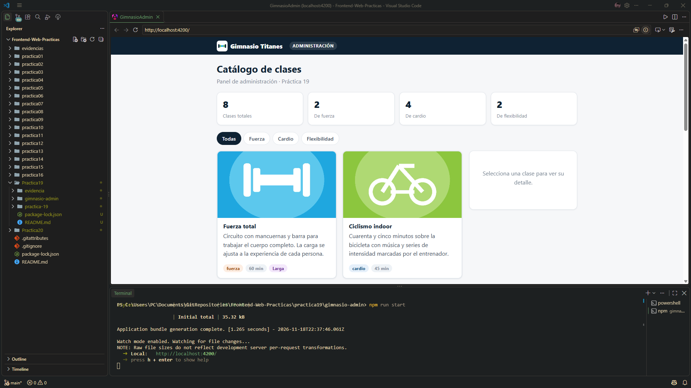

# Practica 19

### ¿Que archivo de Angular hace el papel de `main.tsx`, de `App.tsx` y de `vite.config.ts`?
En angular se cambia asi:
- Lo que antes era `main.tsx` pasa a ser simplemente `main.ts`.
- Lo que antes era `App.tsx` pasa a ser una combinacion de tres documentos, siendo `app.ts`, `app.html` y `app.css`.
- Lo que antes era `vite.config.ts` ahora pasa a ser `angular.json`

### ¿Por que `clase()` lleva parentesis y para que sirve track?
`clase()` lleva parentesis porque `input.required()` devuelve una signal, por lo que hay que llamarla para ller el valor.
Track identifica cada elemento para que Angular reutilice el DOM/componentes y solo actualice lo que cambia el filtrar.

## Evicendias
- Tablero con 8 clases
