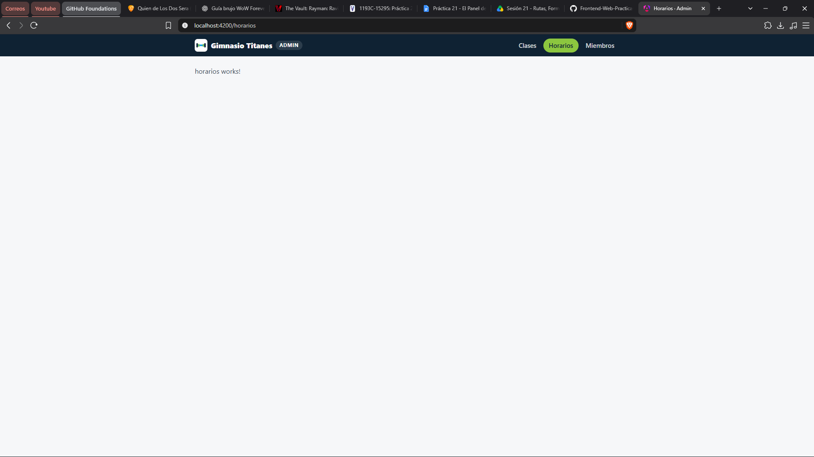
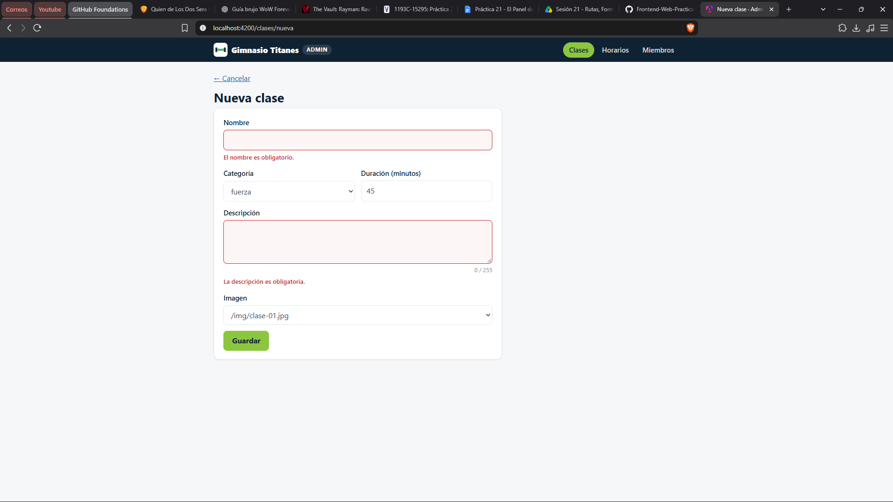
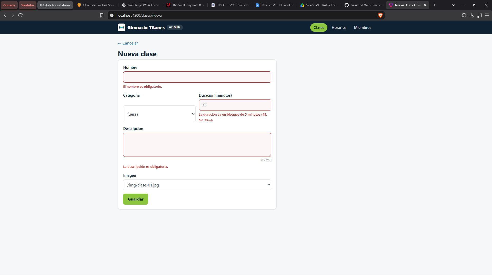
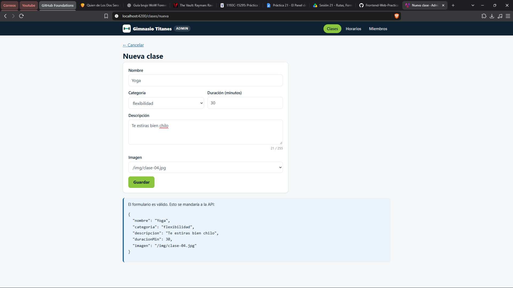

# Practica 21

### ¿Que pieza de React Router corresponde a **router-outlet**, a **routerLink** y a **routerLinkActive**?
Dentro de React Router pasan a ser:
- `router-outlet` a `<Outlet />`
- `routerLink` a `<Link to="...>` o `<NavLink to="...">`
- `routerLinkActive` a `<NavLink className={({ isActive }) => ...}>` o `useLocation()`

### ¿Por que la ruta comodin `(**)` va a l final y la ruta vacia necesita `pathMatch: 'full'`?
Porque Angular evalua las rutas en orden y gana la primera que coincide. `**` coincide con cualquier URL, por eso va al final.
La ruta necesita `pathMatch: 'full'` porque la cadena vacia es prefijo de todas las URLs, sin full, la redireccion a /clases ganaria siempre.

### ¿Donde vive el valor de un campo en un formulario reactivo y en que se diferencia del **useState** de React?
Vive adentro del **FormControl** correspondiente, no en una variable por campo. Se lee directamente. A diferencia del **useState**, el modelo del formulario es la fuente de verdad e incluye valor, validacion, touched, dirty, errors y valueChange. No hace falta un **setState** ni un **onChange** por input.

### ¿Que regresa un validador propio cuando el valor es valido y cuando no, y como se relaciona con **hasError**?
Devuelve un **null** cuando el valor es valido o cuando otro validador debe encargarse, y un objeto **ValidationErrors** cuando es invalido. **hasError** consulta exactamente esa clave con 47 minutos, `47 % 5 != 0`, aparece el error. 

### ¿Que cambio en el servicio del catalogo y por que ningun componente se entero?
La fuente dejo de ser un arreglo local y paso a ser una peticion HTTP reactiva. El servicio desempaqueta `{ data, meta }`, expone **cargando** y **error**, y mantiene las señales/computed que consumen los componentes. Por eso los componentes no necesitan saber de HTTP: el servicio encapsula ese detalle detras de inyeccion de dependencias.

### ¿Por que no hizo falta iniciar sesion para leer el catalogo?
`GET /clases` esta marcado como publico. Aunque existe un guard JWT global, respeta esa metadata. **RolesGuard** tampoco exige nada si no hay `@Roles`. El frontend no envia token, y no lo necesita, solo las escrituras (POST, PATCH, DELETE) requieren administrador.

## Evidencias
- Horarios con enlace activo

- Formulario vacio con mensajes en rojo

- Mensaje del validador con 47 minutos

- Objeto listo para mandar
